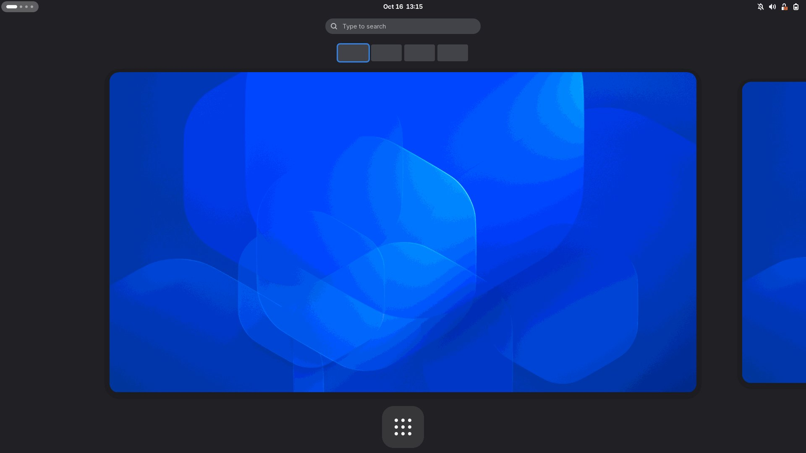
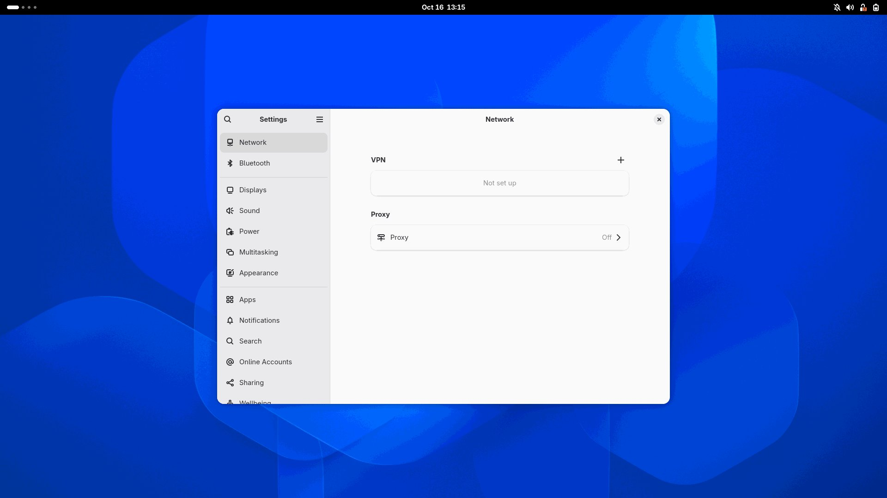
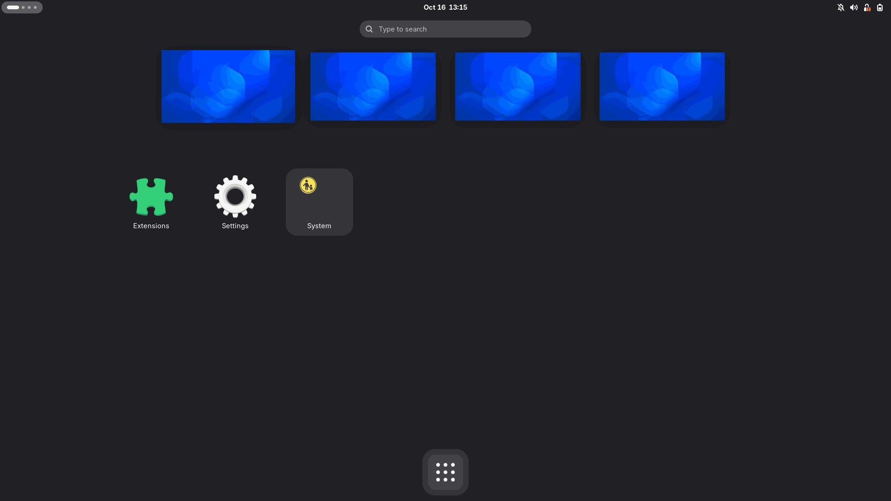

# 📦 Run GNOME Shell in a Container

_:information_source: I want to thank [@amezin](https://github.com/amezin) for his awesome contributions, which made it possible to transition the images from Ubuntu to Fedora._

## The Idea

Developing high-quality GNOME Shell extensions is challenging due to various reasons.
One major issue is the lack of continuous integration possibilities.
So I thought: Why not get GNOME Shell running headlessly on local containers and GitHub Actions runners?

**Here is what works:**

- [x] Multiple containers for modern GNOME Shell versions:
  - [x] [**gnome-shell-pod-41**](https://github.com/Schneegans/gnome-shell-pod/pkgs/container/gnome-shell-pod-41): GNOME Shell 47 (based on Fedora 41)
  - [x] [**gnome-shell-pod-42**](https://github.com/Schneegans/gnome-shell-pod/pkgs/container/gnome-shell-pod-42): GNOME Shell 48 (based on Fedora 42)
  - [x] [**gnome-shell-pod-43**](https://github.com/Schneegans/gnome-shell-pod/pkgs/container/gnome-shell-pod-43): GNOME Shell 49 (based on Fedora 43)
  - [x] [**gnome-shell-pod-44**](https://github.com/Schneegans/gnome-shell-pod/pkgs/container/gnome-shell-pod-44): GNOME Shell 50 (based on Fedora 44)
  - [x] [**gnome-shell-pod-rawhide**](https://github.com/Schneegans/gnome-shell-pod/pkgs/container/gnome-shell-pod-rawhide): Based on Fedora Rawhide, rebuilt weekly.
- [x] **Native Wayland Session**: Runs headlessly under Wayland (`wayland-0`) using Fedora's systemd headless session architecture.
- [x] **1920x1080 Headless Virtual Monitor**: Pre-configured virtual display allows full UI rendering without physical GPU hardware.
- [x] **High-Resolution Screenshots**: Native `screenshot.sh` captures crisp PNG screenshots directly via GNOME Shell's D-Bus interface without requiring ImageMagick.
- [x] **Dynamic Extension Management**: Copy your extension, call `reload-extensions.sh`, and enable it via `gnome-extensions enable`.
- [x] **JavaScript Automation**: Unsafe mode is enabled by default, allowing tests to run arbitrary JavaScript directly in GNOME Shell using `org.gnome.Shell.Eval`.
- [x] **CI Tested**: Automated test suite validates container startup, D-Bus interfaces, and extension lifecycle on every change.

## How Does It Work?

Starting with Version 20, `gnome-shell-pod` has transitioned from legacy X11/Xvfb to a modern, Wayland-native architecture.
The container boots systemd as PID 1, which automatically launches Fedora's `gnome-headless-session@gnomeshell.service`.
GDM's headless login establishes the session and user systemd manager, starting GNOME Shell on Wayland with a persistent 1920x1080 virtual monitor.

The compositor exposes:

- **Wayland display**: `/run/user/1000/wayland-0`
- **User D-Bus**: `/run/user/1000/bus`
- **Xwayland display**: `:0` (if X11 applications are launched)

## How Do I Use It?

You will need [Podman](https://podman.io/) (or Docker). On Ubuntu-like distributions:

```bash
sudo apt-get install podman
```

### Basic Usage

Run the container in detached mode:

```bash
POD=$(podman run --rm --systemd=always --cap-add=SYS_NICE --cap-add=IPC_LOCK --cap-add=CAP_SYS_ADMIN -td ghcr.io/schneegans/gnome-shell-pod-44)

do_in_pod() {
  podman exec --user gnomeshell --workdir /home/gnomeshell "${POD}" set-env.sh "$@"
}
```

Wait until the user bus, Wayland socket, and GNOME Shell are ready:

```bash
do_in_pod wait-user-bus.sh
do_in_pod wait-dbus-interface.sh -d org.gnome.Shell -o /org/gnome/Shell -i org.gnome.Shell.Extensions
```

### Installing and Testing an Extension

Copy your extension into the container:

```bash
podman cp ./my-extension "${POD}:/home/gnomeshell/.local/share/gnome-shell/extensions/my-extension@example.com"
```

Reload extensions and enable it:

```bash
do_in_pod reload-extensions.sh
do_in_pod gnome-extensions enable my-extension@example.com
do_in_pod gnome-extensions info my-extension@example.com
```

### Inspecting Shell State & JavaScript Evaluation

Because `--unsafe-mode` is enabled, you can run JavaScript expressions directly in the GNOME Shell process:

```bash
do_in_pod gdbus call --session \
    --dest org.gnome.Shell \
    --object-path /org/gnome/Shell \
    --method org.gnome.Shell.Eval "imports.ui.main.sessionMode.currentMode"
```

### Taking Screenshots

You can capture a full-resolution 1920x1080 PNG screenshot at any time using `screenshot.sh`:

```bash
do_in_pod screenshot.sh /tmp/capture.png
podman cp "${POD}:/tmp/capture.png" ./capture.png
```

### Stopping the Container

```bash
podman stop "${POD}"
```

## Building and Testing Locally

To build an image locally:

```bash
# Build the default image (Fedora 44)
./scripts/build.sh

# Build a specific version (41, 42, 43, 44, rawhide, or 'all')
./scripts/build.sh 44

# Build and immediately run the verification test suite
./scripts/build.sh 44 --test
```

To run the verification test suite on any existing image:

```bash
# Tests local/gnome-shell-pod:44 by default
./scripts/test.sh

# Or specify any local or remote image tag
./scripts/test.sh local/gnome-shell-pod:44
```

## Capturing Documentation Screenshots

To automate generating the 3 preview screenshots (`capture1.jpg`, `capture2.jpg`, and `capture3.jpg`):

```bash
# Generates the 3 canonical preview images into pictures/
./scripts/capture.sh

# Or specify a custom image tag and output folder
./scripts/capture.sh local/gnome-shell-pod:44 ./pictures/44
```

<p align="center">
  
  
  
</p>

## :octocat: Contributing

Commits should start with a Capital letter and should be written in present tense (e.g. **:tada: Add cool new feature** instead of **:tada: Added cool new feature**).
You should also start your commit message with **one** applicable emoji.

| Emoji                                                     | Description                                   |
| --------------------------------------------------------- | --------------------------------------------- |
| :tada: `:tada:`                                           | When you added a cool new feature.            |
| :wrench: `:wrench:`                                       | When you added a piece of code.               |
| :art: `:art:`                                             | When you improved / added assets like themes. |
| :rocket: `:rocket:`                                       | When you improved performance.                |
| :memo: `:memo:`                                           | When you wrote documentation.                 |
| :beetle: `:beetle:`                                       | When you fixed a bug.                         |
| :twisted_rightwards_arrows: `:twisted_rightwards_arrows:` | When you merged a branch.                     |
| :fire: `:fire:`                                           | When you removed something.                   |
| :truck: `:truck:`                                         | When you moved / renamed something.           |
